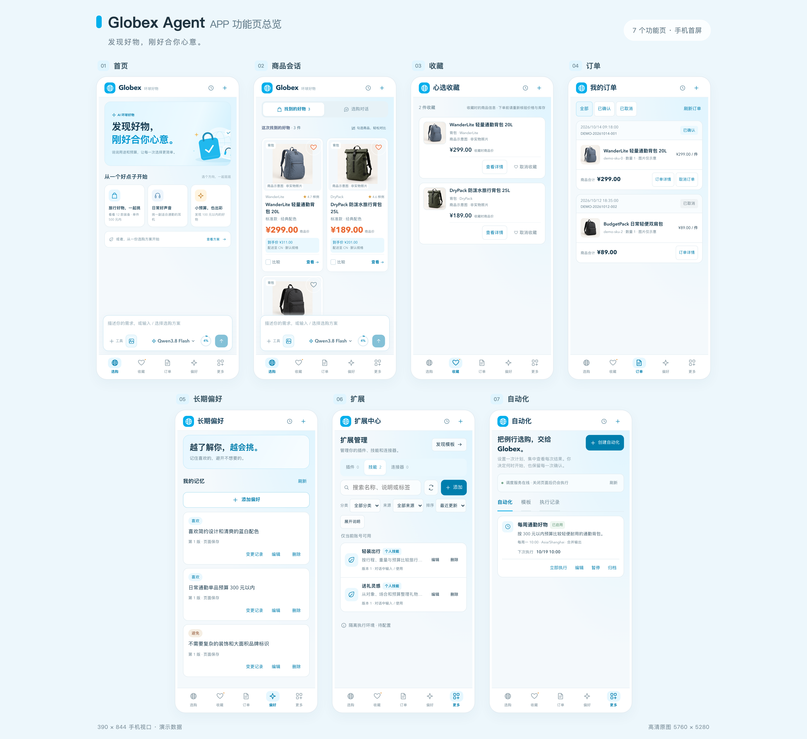
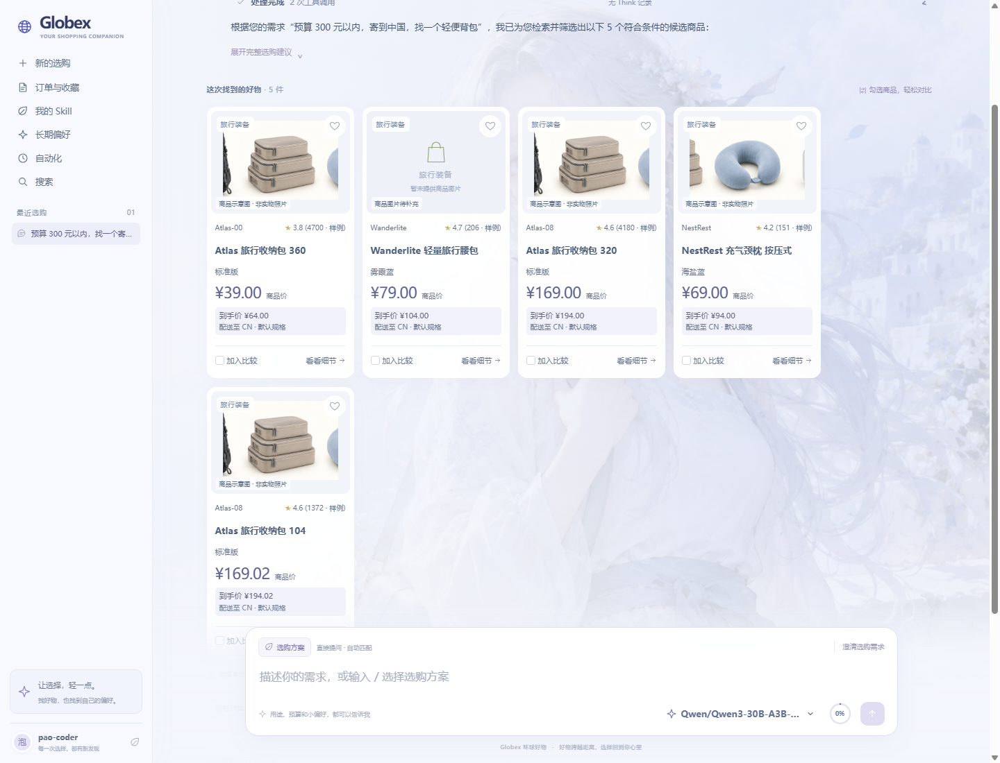
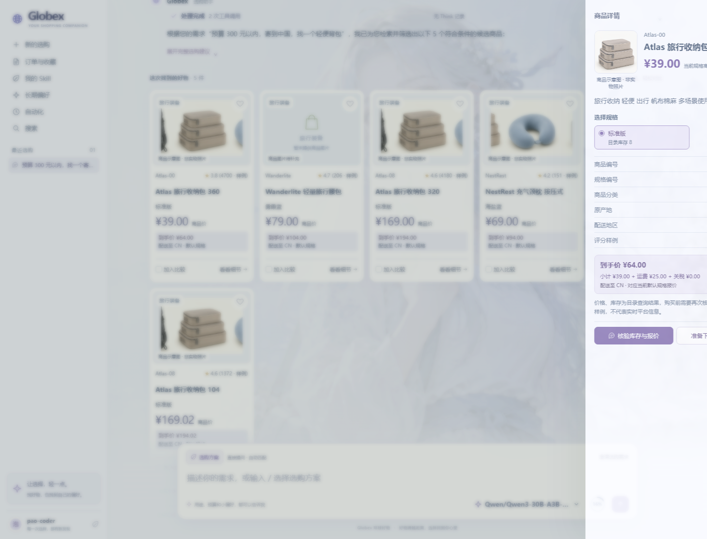
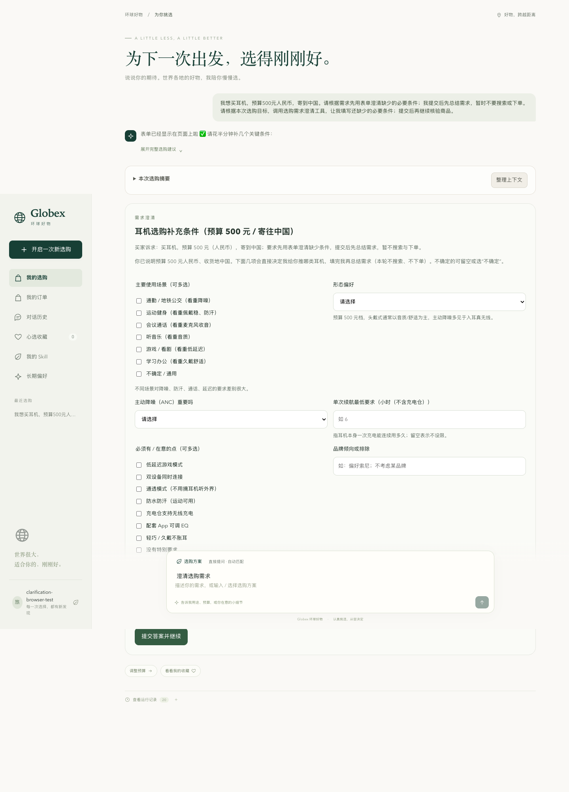
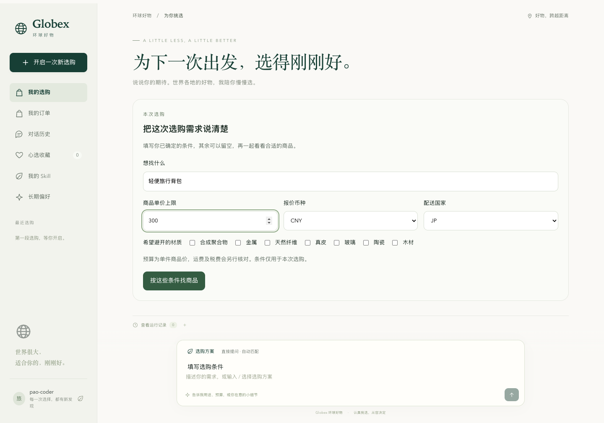
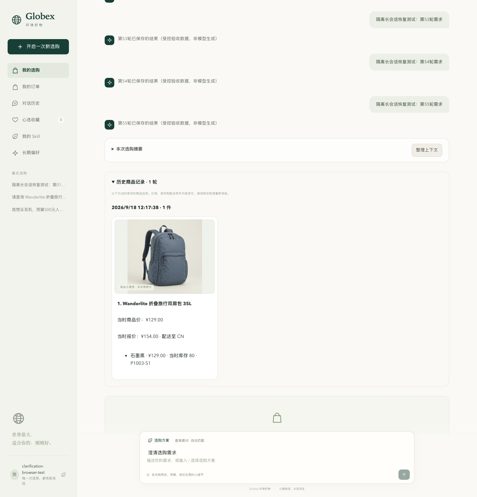
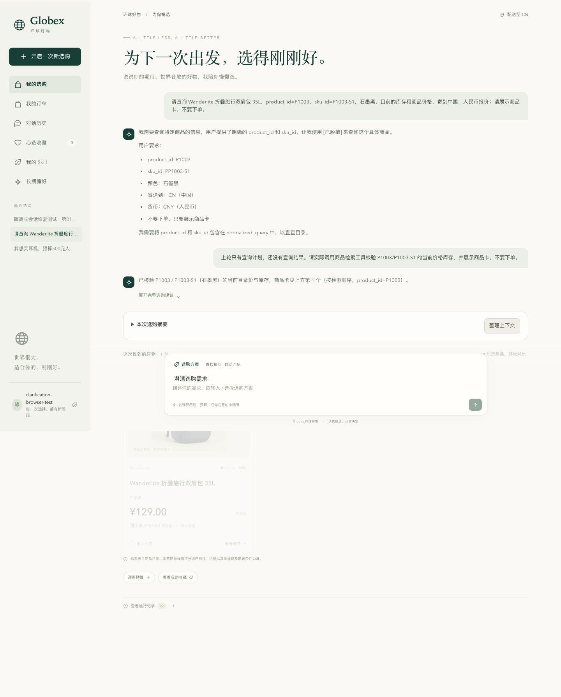
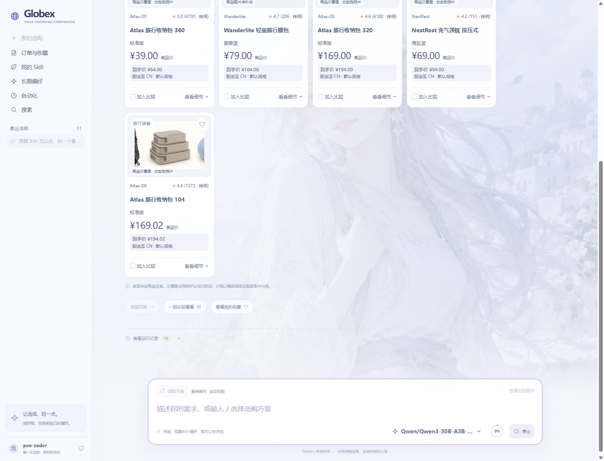
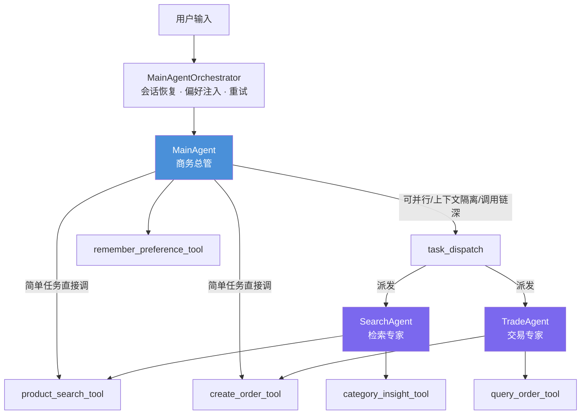
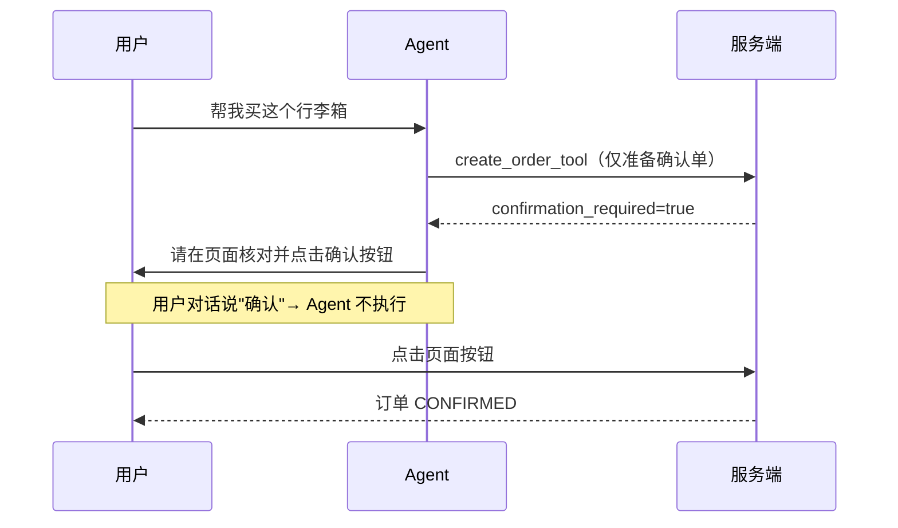

# Globex · 跨境电商选购 Agent

> **案例类型**：AI Agent 产品设计  
> **角色**：AI 产品经理（独立完成产品定义、Agent 设计、工作流规划、评测标准）  
> **技术栈**：AgentScope 2.0 · FastAPI · Qdrant · AG-UI · React  
> **状态**：教学实战工程，产品文档完整，部分收益门禁仍在评测中

[▶ 免费部署指南（Oracle Cloud）](DEPLOY-oracle.md) · [产品文档目录](#文档目录)

---

## 产品一览



> 7 个功能页：首页 · 商品会话 · 收藏 · 订单 · 长期偏好 · 扩展/Skill · 自动化

---

## 一句话

> 用户说「想买个不含塑料的行李箱，预算 800，发到上海」  
> Agent 做：搜索 → 材质过滤 → 到手价 → 记住偏好 → 推荐理由 → 引导确认  
> 用户得到：有依据的清单，全程无需懂平台规则

---

## 我做了什么

这是一个从 0 到 1 完整输出产品思路的 AI Agent 案例。我负责：

| 交付物 | 核心内容 |
|--------|---------|
| [产品需求文档](docs/01-PRD.md) | 用户画像、7 个功能模块的用户故事与验收标准、Out of Scope 边界 |
| [产品设计文档](docs/02-产品设计.md) | 7 个页面结构、商品卡/确认单规范、3 条用户旅程 |
| [Agent 设计文档](docs/03-Agent设计.md) | 三个 Agent 角色定义、记忆系统、上下文治理、安全护栏 |
| [工作流设计文档](docs/04-工作流.md) | 选购/下单/偏好/自动化 7 条完整流程 |
| [架构设计文档](docs/05-架构.md) | 四层架构、数据流、部署模式、可观测性 |
| [风险与迭代路径](docs/06-风险迭代.md) | 风险矩阵、4 阶段迭代规划、各角色行动建议 |

---

## 核心功能截图

### 搜索结果 · 到手价内联



用户输入「预算 300 元以内，发到中国，找一个轻便箱包」，Agent 返回 5 件候选，每张商品卡内联到手价（商品价 + 运费 + 关税合计），用户无需自己换算。

---

### 商品详情 · 价格明细



右侧详情面板展示完整到手价拆分：商品 ¥39.00 + 运费 ¥25.00 + 关税 ¥0.00 = 到手 ¥64.00。所有数字来自工具返回，Agent 不自行计算。

---

### 澄清表单 · 动态生成



用户说「想买耳机，预算 500」，Agent 判断缺少关键选购条件，动态生成问卷：使用场景（多选）、形态偏好、主动降噪需求、续航要求、品牌倾向……表单字段由 Agent 根据本轮上下文生成，不是固定模板。

---

### 结构化选购入口



除了自由对话，首页提供结构化输入：商品描述 + 价格上限 + 币种 + 配送国 + 希望避开的材质。材质过滤在这里是前端选项，背后映射到 `excluded_material_tags` 硬约束传入检索链路。

---

### 会话持久化 · 服务重启后恢复



服务重启后，历史商品记录完整保留——包括当时的报价快照（¥129.00，当时报价 ¥154.00 · 配送至 CN）。会话状态通过 AgentState 持久化到 SQLite，重启后无缝恢复。

---

### ReAct 推理过程可见



前端可展开「运行记录」，看到 Agent 的思考链：「上轮只有查询计划，还没有查询结果。请实际调用商品检索工具核验 P1003/P1003-S1 的当前价格库存」——这是 ReAct（思考→工具调用→观察→再思考）循环的真实过程，不是包装后的结果展示。

---

### AI 流式输出



Agent 回复逐字流式渲染，商品卡在工具调用完成后立即插入到对话流中，不等全文完成。底部状态栏实时显示当前模型（Qwen/Qwen3-30B-A3B）和 Token 用量百分比。

---

## 产品架构



---

## 三个最值得聊的产品决策

### 决策 1：dislike 偏好为什么不能走"相关性截断"

> **背景**：用户偏好越积越多，全量注入会撑满上下文。自然的方案是按语义相关性取 top_k。  
> **问题**：用户说「不要塑料」，但本轮 query 是「推荐个咖啡杯」——两者向量相似度很低，top_k 会把"不要塑料"排掉。  
> **结果**：AI 推了一只塑料杯。

这不是体验问题，是**安全问题**。

```
like 偏好（风格喜好）     → 按相关性取 top_k   漏掉 = 推荐不够贴  ✅ 可接受
dislike 偏好（忌口/黑名单）→ 全量保留，不截断   漏掉 = 推了用户拒绝的  ❌ 安全问题
```

两种偏好的失败代价完全不对称，必须分开处理。这个判断后来成为安全评测的 **0 误放行门禁**。

---

### 决策 2：为什么偏好不能写进 System Prompt

> **直觉做法**：把「[dislike] 不要塑料」直接拼进 System Prompt，简单直接。  
> **实际问题**：System Prompt 是 Prompt Cache 的稳定前缀。每个用户偏好不一样 → 每个用户前缀不同 → Cache 命中率归零 → Token 成本飙升。

```
❌ System Prompt = 角色定义 + 工具说明 + 用户偏好
   每个用户都不同 → Cache 全部失效

✅ System Prompt = 角色定义 + 工具说明（所有用户共享，Cache 稳定）
   <buyer-preferences> = 独立 hint 消息（因人而异，不进 Cache）
```

个性化和缓存效率不是对立的，关键是在架构层把「稳定内容」和「因人而异内容」分开。

---

### 决策 3：下单操作为什么只能在页面完成



**核心逻辑**：Agent 对自然语言的理解可能出错，但确认单是结构化数据——用户看到的就是将要执行的，不存在理解偏差。人类确认的不是 Agent 的文字描述，而是结构化事实本身。

---

## 安全评测框架

```
安全契约（0 误放行，自动化测试保证）
├── dislike 材质漏判 → 不出现在推荐中
├── 超价格约束商品混入 → 只在 filtered_out，不在 hits
├── 下单安全 → Agent 不声称"已下单"
└── 偏好写入 → 必须经用户原生审批

效果门禁（仍在评测中）
├── Recall@10（召回率）
└── MRR（平均倒数排名）

成本门禁
└── 单次 Token 消耗 ≤ 基线 × 1.1
```

---

## 产品边界（主动选择不做的事）

| 不做什么 | 为什么 |
|---------|--------|
| 自动支付 | AI 理解错误的代价太高，必须人工确认 |
| 物流追踪 | 超出「选购决策辅助」的产品定位 |
| 比价多平台 | 先把自有目录做深，避免信息不一致 |
| 退货/售后 | 当前阶段用户信任还没建立到这个深度 |

---

## 已知限制（诚实评估）

- 商品来自样例目录，不是真实电商供给
- 部分收益门禁（召回率、MRR）仍在评测中
- 关税估算是静态规则，非实时税率数据
- Reranker 未配置时降级为向量分排序，搜索质量有损

---

## 本地运行

需要：Python 3.11–3.13 · Node.js 22 · 支持 OpenAI 兼容协议的模型 API Key

```bash
# 1. 克隆原始工程
git clone https://github.com/原始仓库/globex-agent.git
cd globex-agent

# 2. 配置模型
cp .env.example .env
# 编辑 .env，填写 LLM_BASE_URL / LLM_API_KEY / LLM_MODEL

# 3. 启动后端
uv sync --frozen
uv run uvicorn app.presentation.server:create_app --factory --port 8000

# 4. 启动前端（另开终端）
npm --prefix frontend ci
npm --prefix frontend run dev
# 访问 http://localhost:5173
```

详见 [原始项目 README](https://github.com/原始仓库/globex-agent)

---

## 文档目录

- [01 · 产品需求文档](docs/01-PRD.md)
- [02 · 产品设计文档](docs/02-产品设计.md)
- [03 · Agent 设计文档](docs/03-Agent设计.md)
- [04 · 工作流设计文档](docs/04-工作流.md)
- [05 · 架构设计文档](docs/05-架构.md)
- [06 · 风险与迭代路径](docs/06-风险迭代.md)

---

<sub>本项目基于开源教学工程 globex-agent 独立完成产品分析与文档设计。产品文档为原创输出，工程代码由原项目提供。</sub>
